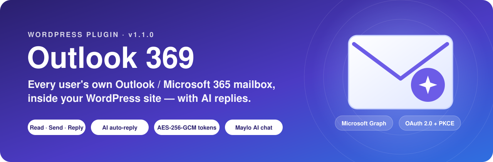
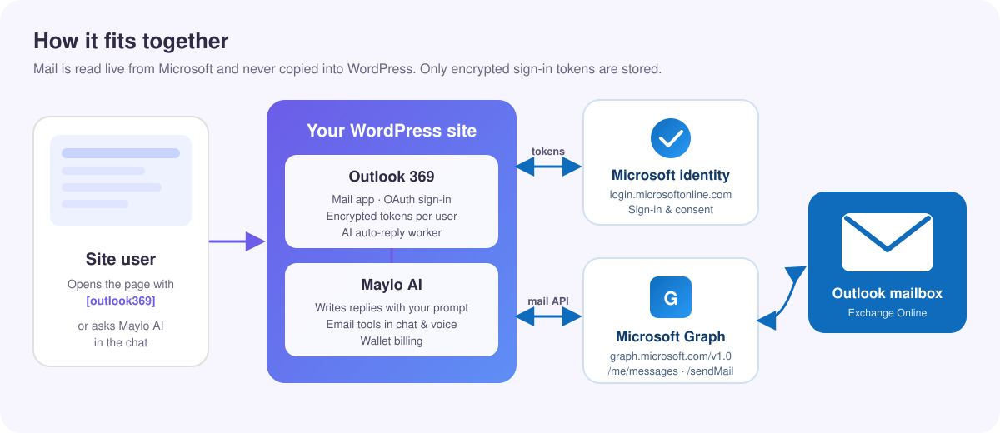
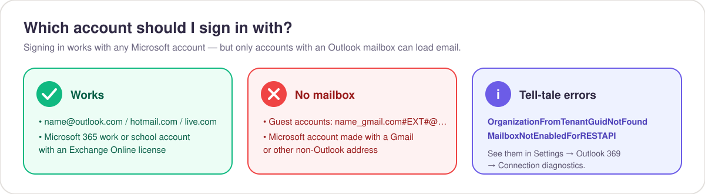
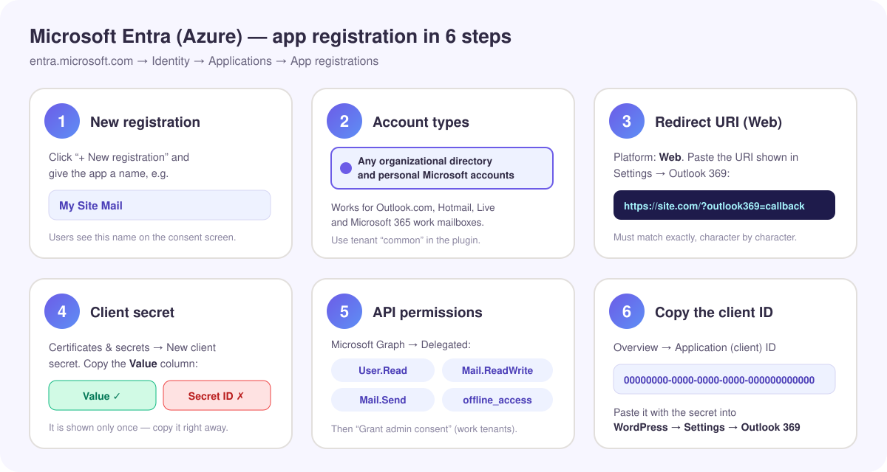
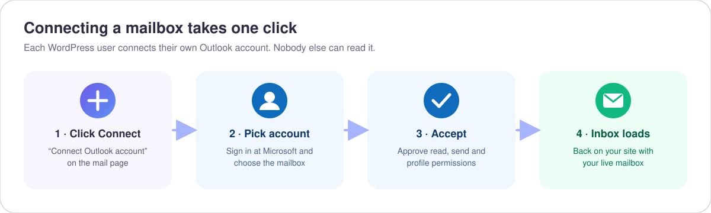
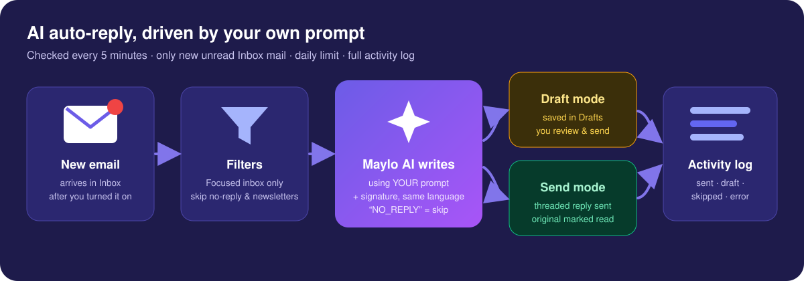

<p align="center">
  
</p>

<p align="center">
  
  
  
  
  
</p>

<p align="center">
  <b>Connect Outlook to your WordPress site in about 10 minutes.</b><br>
  <sub>Each user signs in with their own Microsoft account, reads and sends mail from your site, and can let AI draft or send replies with their own prompt.</sub>
</p>

<p align="center">
  <a href="docs/outlook369-documentation.html"></a>
  <a href="https://github.com/deveguru/Microsoft365-azure-outlook/raw/main/docs/outlook369-documentation.html"></a>
</p>

<br>

## 📑 Contents

| | | |
|---|---|---|
| [✨ What you get](#-what-you-get) | [🧭 How it works](#-how-it-works) | [✅ Before you start](#-before-you-start) |
| [☁️ Step 1 · Azure / Entra](#️-step-1--register-the-app-in-microsoft-entra-azure) | [⚙️ Step 2 · WordPress](#️-step-2--configure-wordpress) | [📬 Step 3 · Connect a mailbox](#-step-3--users-connect-their-mailbox) |
| [🤖 AI replies & auto-reply](#-ai-replies-and-auto-reply) | [💬 Maylo AI chat](#-use-your-email-from-the-maylo-ai-chat) | [🔐 Security & privacy](#-security-and-privacy) |
| [🩺 Troubleshooting](#-troubleshooting) | [❓ FAQ](#-faq) | [🧑‍💻 For developers](#-for-developers) |

<br>

## ✨ What you get

<table>
  <tr>
    <td width="33%" valign="top">
      <h3>📬 A full mail app</h3>
      Folders, search, read, threaded replies, forward, flag, archive, delete and attachments — inside any page with the <code>[outlook369]</code> shortcode.
    </td>
    <td width="33%" valign="top">
      <h3>👤 One mailbox per user</h3>
      Every WordPress user connects their <b>own</b> Microsoft account. Tokens are encrypted per user, and nobody else can open that mailbox.
    </td>
    <td width="33%" valign="top">
      <h3>🤖 AI that writes like you</h3>
      Press ✨ to have AI draft a reply, or switch on <b>auto-reply</b>: new emails are answered every 5 minutes using your own prompt and signature.
    </td>
  </tr>
  <tr>
    <td width="33%" valign="top">
      <h3>💬 Talk to your inbox</h3>
      With <a href="https://github.com/deveguru/maylo-ai">Maylo AI</a> you can ask “what new emails do I have?”, get summaries, and send or reply from the chat — even by voice.
    </td>
    <td width="33%" valign="top">
      <h3>🛡️ Private by design</h3>
      Mail is fetched live from Microsoft and never stored in WordPress. Email bodies render in a locked-down sandbox and remote images are blocked by default.
    </td>
    <td width="33%" valign="top">
      <h3>🩺 Clear diagnostics</h3>
      The settings page logs every connection attempt with Microsoft's exact answer, so problems like “no mailbox” are obvious.
    </td>
  </tr>
</table>

<br>

## 🧭 How it works

<p align="center"></p>

1. The user opens your mail page and clicks **Connect Outlook account**.
2. They sign in **at Microsoft** (your site never sees their password) and approve the permissions.
3. Microsoft returns a one-time code; Outlook 369 exchanges it for tokens using **OAuth 2.0 with PKCE** and stores them **encrypted** for that user.
4. From then on the mail app, the AI assistant and Maylo AI talk to **Microsoft Graph v1.0** on that user's behalf. Tokens refresh automatically.

<br>

## ✅ Before you start

| You need | Notes |
|---|---|
| 🌐 **A WordPress site on HTTPS** | WordPress 6.0+, PHP 7.4+ with the **OpenSSL** extension. |
| 🔑 **A Microsoft Entra (Azure) account** | Free. Used once by the site owner to register the app. |
| 📮 **Users with a real Outlook mailbox** | Outlook.com / Hotmail / Live accounts, or Microsoft 365 accounts with an **Exchange Online** license. |
| 🤖 *(optional)* **Maylo AI plugin** | Needed for AI replies, auto-reply and email tools in the chat. |

<p align="center"></p>

> [!IMPORTANT]
> If you created your Azure account with a **Gmail** address, the directory Azure made for you has **no mailbox**. Signing in with that account shows a name like `you_gmail.com#EXT#@yourname.onmicrosoft.com` and Microsoft answers `OrganizationFromTenantGuidNotFound`. Sign in with an **@outlook.com** (free) or **Microsoft 365** mailbox instead.

<br>

## ☁️ Step 1 · Register the app in Microsoft Entra (Azure)

<p align="center"></p>

<details open>
<summary><b>Click-by-click</b></summary>

1. Go to **[entra.microsoft.com](https://entra.microsoft.com)** → **Identity** → **Applications** → **App registrations** → **+ New registration**.
2. **Name:** anything your users will recognize, e.g. `My Site Mail`.
3. **Supported account types:** choose **“Accounts in any organizational directory and personal Microsoft accounts”**.
4. **Redirect URI:** platform **Web**, value = the URI shown in **WordPress → Settings → Outlook 369** (by default `https://your-site.com/?outlook369=callback`). Click **Register**.
5. **Certificates & secrets** → **+ New client secret** → copy the **Value** column right away (not the *Secret ID*).
6. **API permissions** → **+ Add a permission** → **Microsoft Graph** → **Delegated permissions** → add
   `User.Read`, `Mail.ReadWrite`, `Mail.Send`, `offline_access` (plus `openid`, `profile`, `email`).
   In a work tenant click **Grant admin consent**.
7. **Overview** → copy the **Application (client) ID**.

</details>

> [!TIP]
> The redirect URI must match **exactly**, including `https`, the trailing `/` and the `?outlook369=callback` part. A mismatch is the #1 cause of the `invalid_request` / `AADSTS50011` error.

<br>

## ⚙️ Step 2 · Configure WordPress

| Field in **Settings → Outlook 369** | What to enter |
|---|---|
| **Application (client) ID** | The ID from step 7 above |
| **Client secret** | The secret **Value** from step 5 (stored encrypted with AES-256-GCM) |
| **Directory (tenant)** | `common` → personal **and** work accounts *(recommended)* · `consumers` → only Outlook.com · `organizations` or a tenant ID → only work accounts |
| **Who can use the mailbox** | Any logged-in user, or only users with a capability |
| **Allow sending** · **Images** · **Attachments** | Your preferences (attachments up to 3 MB per message) |

Then put the shortcode on any page (for example your user panel):

```text
[outlook369 title="My Mail" height="760"]
```

<details>
<summary><b>Prefer to keep secrets in <code>wp-config.php</code>?</b></summary>

```php
define( 'OUTLOOK369_CLIENT_ID', '00000000-0000-0000-0000-000000000000' );
define( 'OUTLOOK369_CLIENT_SECRET', 'your-secret-value' );
define( 'OUTLOOK369_TENANT', 'common' );
```

</details>

<br>

## 📬 Step 3 · Users connect their mailbox

<p align="center"></p>

That's it — the inbox loads on your site. Users can disconnect at any time from the bottom of the folder list; their tokens are deleted immediately.

| In the mail app | |
|---|---|
| 📁 Folders | Inbox, Drafts, Sent, Archive, Deleted, Junk and your own folders (with unread counts) |
| 🔎 Search | Searches the whole mailbox |
| ↩️ Reply | Real threaded replies (the original is quoted, the conversation stays together) |
| ⭐ Flag · 🗄️ Archive · 🗑️ Delete | Delete moves to *Deleted Items* |
| 📎 Attachments | Download received files; attach up to 3 MB when sending |
| 🖼️ Images | Remote images blocked until you click **Load images** |
| 📱 Mobile | Folder drawer, full-screen reader and compose |

<br>

## 🤖 AI replies and auto-reply

<p align="center"></p>

**✨ AI reply button** — open any email and press ✨. The AI writes a reply in the sender's language using your prompt and signature, and opens it in the compose window for you to edit and send.

**✨ AI panel** (top bar) — every user sets their own:

| Setting | What it does |
|---|---|
| **Automatic smart replies** | On/off. Only emails that arrive **after** you turn it on are answered. |
| **When AI writes a reply** | **Draft** (saved in *Drafts* for review — default) or **Send** automatically |
| **Your reply prompt** | How to answer: your business, tone, what to offer, what never to promise |
| **Signature** | Added to every AI reply |
| **Max replies per day** | Safety limit (default 20) |
| **Focused inbox only** · **Skip no-reply senders** | Keeps newsletters and notifications out |
| **AI activity** | Log of every *sent*, *draft*, *skipped* and *error* with the reason |

<details>
<summary><b>Example prompt</b></summary>

```text
You are the assistant of Virtual Copilot, an AI automation agency in the Netherlands.
Answer in a short, warm and professional tone. For new leads, thank them and offer a
free 15-minute discovery call. Never quote prices or deadlines; say we will follow up.
If someone asks for support, ask for their order number.
```

</details>

> [!NOTE]
> Auto-reply runs on WP-Cron every 5 minutes (max 5 emails per run). For reliable timing add a real server cron job:
> ```bash
> */5 * * * * wget -q -O - https://your-site.com/wp-cron.php?doing_wp_cron >/dev/null 2>&1
> ```
> AI replies are written by **Maylo AI** and charged to the user's wallet like any other Maylo AI request.

<br>

## 💬 Use your email from the Maylo AI chat

When **Outlook 369** and **[Maylo AI](https://github.com/deveguru/maylo-ai)** are both active, the assistant gets these tools:

| Tool | Try saying |
|---|---|
| `list_emails` | “What new emails do I have?” · “Find the email from Sara about the invoice” |
| `read_email` | “Read it and summarize in three bullet points” |
| `draft_email_reply` | “Write a polite reply and save it as a draft” |
| `reply_email` | “Reply that we can meet on Tuesday at 10 — send it” |
| `send_email` | “Email ali@example.com the weekly report” |
| `email_auto_reply` | “Turn on auto-reply in draft mode with this prompt: …” |

> [!CAUTION]
> The assistant never sends on its own: before `send_email` or `reply_email` it shows the recipients and the final text and asks for confirmation, unless you clearly say “send it directly”. In **live voice**, questions like “any new emails?” are answered out loud; sending switches to the chat to finish.

<br>

## 🔐 Security and privacy

| | |
|---|---|
| 🔑 **Sign-in** | Microsoft identity platform, authorization code flow with **PKCE** and a one-time `state` |
| 🗝️ **Tokens** | Encrypted per user with **AES-256-GCM** (key derived from your WordPress salts) |
| 📭 **Mail data** | Fetched live from Microsoft Graph, **never stored** in the WordPress database |
| 🧱 **Email display** | Sandboxed iframe with a strict Content-Security-Policy; scripts, forms and frames removed |
| 🖼️ **Tracking pixels** | Remote images blocked by default |
| 🧾 **Requests** | WordPress nonces and capability checks on every action |
| 🚪 **Disconnect** | Deletes the user's tokens immediately; deleting a WP user deletes theirs too |

<br>

## 🩺 Troubleshooting

> Open **Settings → Outlook 369 → Connection diagnostics**. It lists the last 30 attempts with the Microsoft account used, its type (*personal / work / guest*), the tenant that signed it in and Microsoft's exact error.

| You see | Cause | Fix |
|---|---|---|
| `invalid_request` / `AADSTS50011` | Redirect URI mismatch | Copy the URI from the plugin settings into Entra → Authentication → **Web** |
| `AADSTS7000215` invalid client secret | The **Secret ID** was pasted, or the secret expired | Create a new secret and paste its **Value** |
| `AADSTS50020` account does not exist in tenant | Tenant set to one directory | Set tenant to `common` |
| Account shows `…#EXT#@….onmicrosoft.com` · `OrganizationFromTenantGuidNotFound` | Guest account in a directory with no Exchange Online | Sign in with an Outlook.com or Microsoft 365 mailbox |
| `MailboxNotEnabledForRESTAPI` | Microsoft account created with Gmail or another address — no Outlook mailbox | Use (or create) an @outlook.com address |
| “Need admin approval” | Work tenant blocks user consent | An admin clicks **Grant admin consent** in API permissions |
| “Microsoft is temporarily limiting requests” | Throttling (HTTP 429) | Wait the seconds shown and try again |
| Auto-reply does nothing | WP-Cron not running, Maylo AI inactive or wallet empty | Add the server cron above, activate Maylo AI, check the **AI activity** log |

<br>

## ❓ FAQ

<details><summary><b>Does the site see my Microsoft password?</b></summary>No. You sign in on Microsoft's own page; the site only receives tokens that it stores encrypted.</details>
<details><summary><b>Can one user read another user's mail?</b></summary>No. Every token belongs to one WordPress user and is checked on every request.</details>
<details><summary><b>Is my email copied into WordPress?</b></summary>No. Messages and attachments are fetched live from Microsoft each time. Only the AI activity log keeps a short note of what was answered.</details>
<details><summary><b>Does it work with Gmail?</b></summary>This plugin is for Outlook / Microsoft 365. Gmail is handled by Google services in the VirtualCopilot user panel.</details>
<details><summary><b>Will the AI reply to newsletters or no-reply senders?</b></summary>No — they are skipped by default, and the AI itself can decide an email needs no reply.</details>
<details><summary><b>How do I stop everything?</b></summary>Turn off auto-reply in the ✨ panel, or click <b>Disconnect</b>. Disconnecting deletes the stored tokens.</details>

<br>

## 🧑‍💻 For developers

<details>
<summary><b>PHP API</b> (used by Maylo AI)</summary>

```php
$o = Outlook_369::instance();

$o->api_is_connected( $user_id );                                   // bool
$o->api_status( $user_id );                                         // account + auto-reply state
$o->api_list( $user_id, array( 'folder' => 'inbox', 'unread_only' => true, 'limit' => 10 ) );
$o->api_get( $user_id, $message_id );                               // full message, body as text
$o->api_send( $user_id, array( 'to' => 'a@b.com', 'subject' => 'Hi', 'body' => 'Text' ) );
$o->api_reply( $user_id, $message_id, 'Text', array( 'reply_all' => false, 'draft' => false ) );
$o->ai_draft_for( $user_id, $message_id, 'optional instruction' );  // AI reply text + html
$o->ai_settings( $user_id );  $o->ai_save_settings( $user_id, array( 'auto' => true, 'mode' => 'draft' ) );
```

All methods return arrays or a `WP_Error`.

</details>

<details>
<summary><b>Hooks</b></summary>

| Hook | Type | |
|---|---|---|
| `outlook369_connected` | action | `( $user_id, $account )` after a successful connection |
| `outlook369_disconnected` | action | `( $user_id )` |
| `outlook369_scopes` | filter | Change the requested Microsoft Graph scopes |

</details>

<details>
<summary><b>Changelog</b></summary>

| Version | |
|---|---|
| **1.1.0** | AI reply button, prompt-driven auto-reply (draft / send), AI activity log, real threaded replies, public PHP API, Maylo AI email tools |
| **1.0.5** | Microsoft's real error codes shown, account-type detection (personal / work / guest), connection diagnostics log, "use a different account" |
| **1.0.4** | Fixed stored connection not being read back; folder list now uses Graph v1.0 properties only |

</details>

<br>

<p align="center"></p>

<p align="center">
  <b>Developed by <a href="https://alirezafatemi.ir">alirezafatemi.ir</a> · <a href="https://369web.ir">369web.ir</a></b>
</p>
